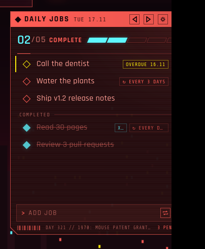
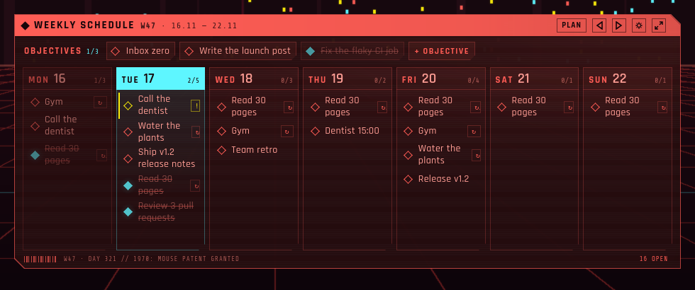
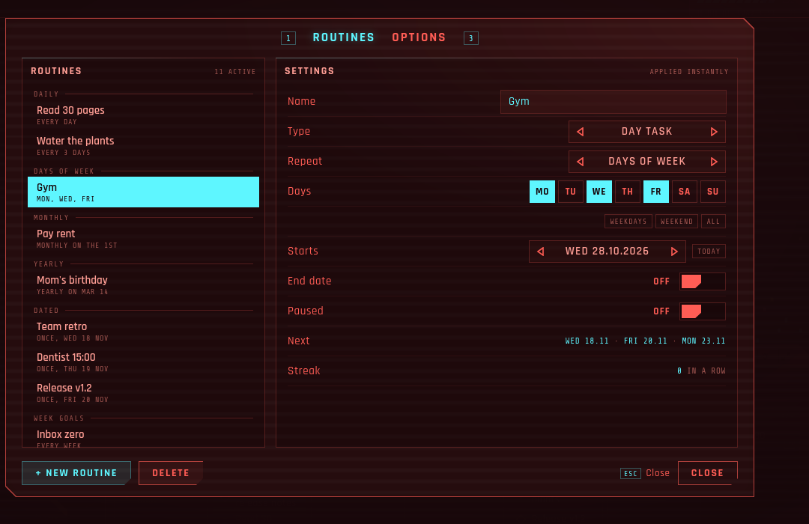

# CyberTasks

**Daily jobs, week plans and routines that repeat by themselves, right on your desktop.**
A productivity widget in the Night Cron style (dark panels, red frames, cyan selection), built
for [WidgetSystem](https://github.com/NGdev2/WidgetSystem). It also runs standalone with `./run.sh`.

<p>
  
  
</p>

Two views share one database:

- **Daily Jobs**: today's tasks. Add with the input, tick the diamond, right-click a row for
  more (skip, move to tomorrow, rename, make it a routine). Unfinished one-off tasks carry over
  as *overdue*. Browse other days with ◁ ▷. Finish everything for an `ALL JOBS COMPLETE · EXIT 0` banner.
- **Week Plan**: the goals you planned for this week, as compact as Daily Jobs. Press **7D**
  for the full **Weekly Schedule**: seven day columns and the week's goals. Add a job to any
  day, drag one-off jobs between days, and plan ahead with ◁ ▷.

**Routines** (⚙ or right-click → Routines…) repeat by themselves and appear on their days:

| Repeat | Example |
|---|---|
| Every day / every N days | Drink water; water plants every 3 days |
| Days of week | Gym on Mon, Wed, Fri; weekdays only |
| Day of month | Pay rent on the 1st; review budget on the last day |
| Date each year | Birthday on Mar 14 (Feb 29 falls on Feb 28 in other years) |
| On one date | Dentist on Thu 20 Nov |
| Week goal: every week / one week | "Read 100 pages" every week |

Each routine can have a start date, an end date and a pause switch. The editor previews its
next dates and shows its streak.



**Options:** carry over unfinished jobs, completed jobs at the bottom, morning briefing and
evening reminder notifications, celebration banner, glitch effects, decorative elements.

## Run it

**Standalone** (no WidgetSystem needed; Linux with Python 3, GTK 3 and WebKit2GTK 4.1, preinstalled on Ubuntu 22.04+):

```bash
git clone https://github.com/NGdev2/CyberTasks && cd CyberTasks
./run.sh            # ./run.sh stop to stop it, ./run.sh theme glass to switch the look
```

**Inside [WidgetSystem](https://github.com/NGdev2/WidgetSystem)**, next to your other widgets:
open ✦ → Navigator… → CyberTasks → Install, then add "Daily Jobs" and "Week Plan". Or from a terminal:

```bash
widgetctl install cybertasks
widgetctl add cybertasks:day && widgetctl add cybertasks:week
```

From scripts: `widgetctl send cybertasks '{"add":"Buy milk"}'` adds a job for today, and
`'{"open":"routines"}'` opens the editor. (When it runs standalone, use `./run.sh send …`.)

## Development

- `src/schedule.js` is the pure recurrence engine. Its data model is in
  [docs/DATA_MODEL.md](docs/DATA_MODEL.md). Run the tests with `npm test` (`node --test`, no dependencies).
- `src/day.js`, `src/week.js`, `src/editor.js` and `src/rows.js` are the views. `style.css`
  is the design kit.
- `solo/` is the bundled runner (a copy of WidgetSystem, made by `widgetctl export-solo`); don't edit it.
- Saving any file hot-reloads the widget. Data lives in WidgetSystem's storage
  (`~/.local/share/widgetsystem/storage/w-cybertasks.json`).

Colors and fonts come from the WidgetSystem theme (Night Cron by default: Rajdhani and Share Tech
Mono, both SIL OFL). Not affiliated with CD PROJEKT RED.
